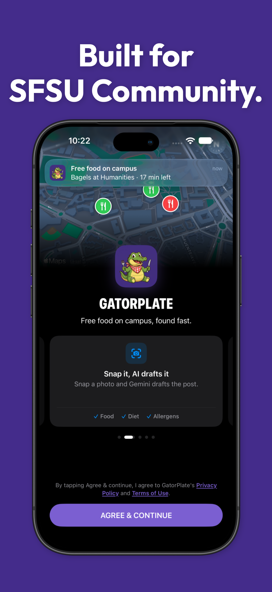
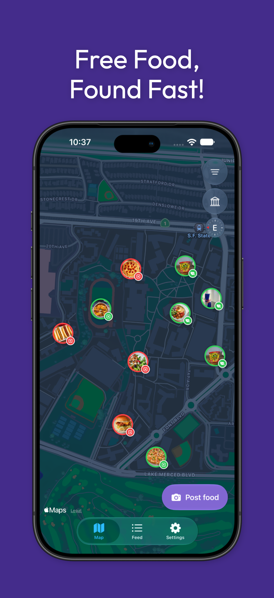
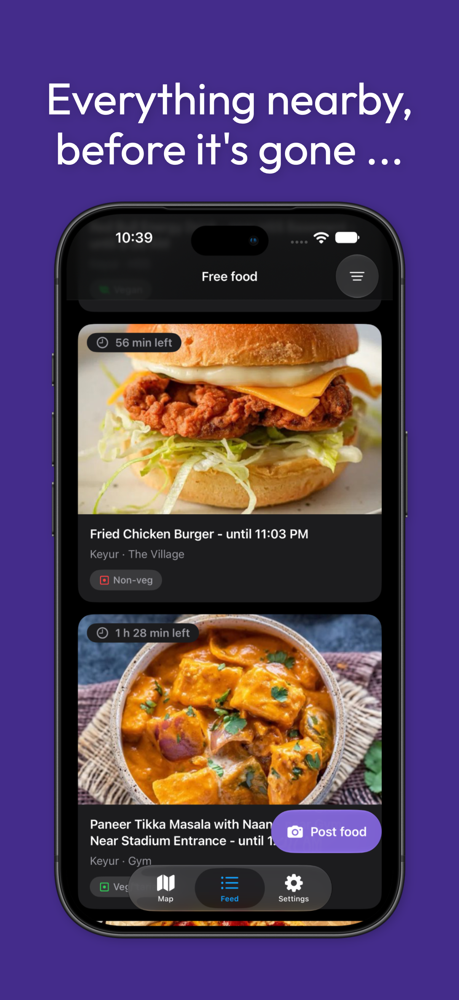
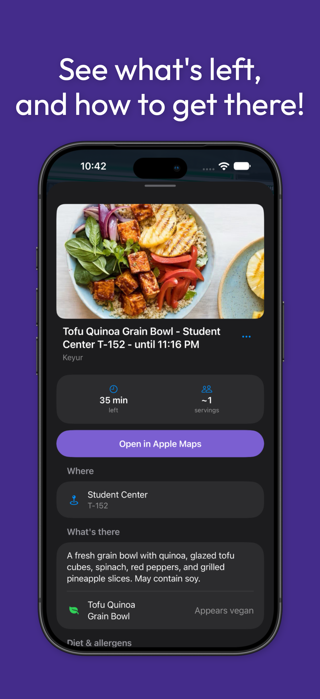
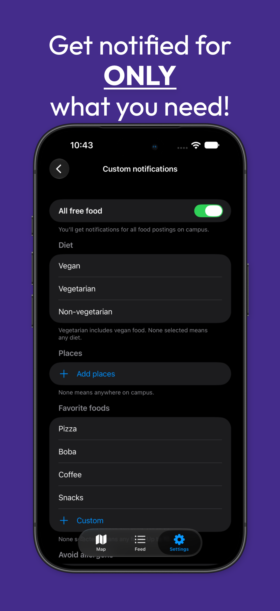
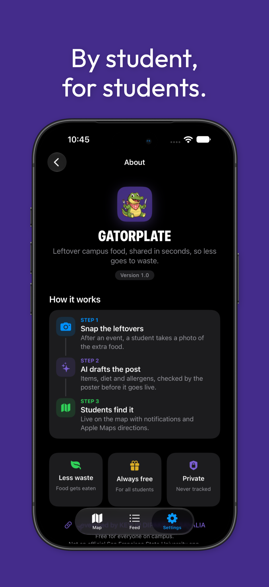
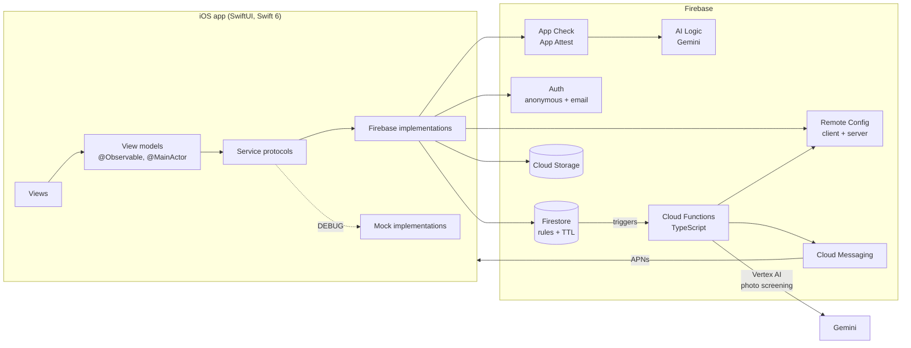
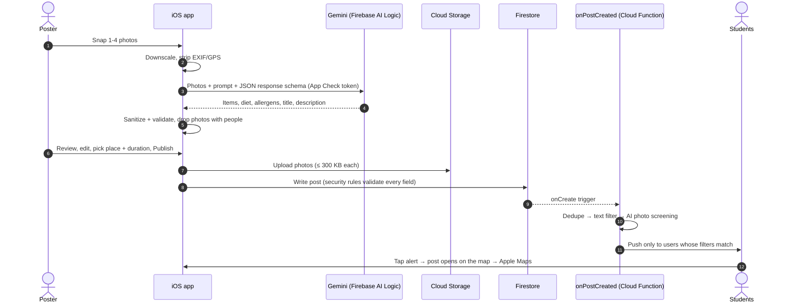

<div align="center">


# GatorPlate

**Free food on campus, found fast.**

Leftover campus food, shared in seconds, so less goes to waste.<br/>
Snap a photo, AI drafts the post, and students nearby get notified and walk over.

<a href="https://apps.apple.com/us/app/gator-plate/id6826729237">
  
</a>

<br/><br/>


-F05138?logo=swift&logoColor=white)


[The story](#the-story) •
[Features](#features) •
[Screenshots](#screenshots) •
[Architecture](#architecture) •
[Tech stack](#tech-stack) •
[Challenges](#engineering-challenges) •
[What I learned](#what-i-learned) •
[Run it locally](#running-locally)

</div>

---

## At a glance

| | |
|---|---|
| **What** | A native iOS app where SFSU students and student orgs post leftover food, and other students find it on a live campus map. |
| **Why** | Evening club events end with good food in the trash because the official channel needs a trained staff member to post. |
| **How** | Photo → Gemini drafts the post (items, diet, allergens, description) → poster reviews and publishes → filtered push alerts → Apple Maps directions. |
| **Goal** | Under **15 seconds** from opening the app to a published post, with no typing in the happy path. |
| **Scale of the build** | ~19K lines of Swift across ~250 files, ~2.7K lines of TypeScript Cloud Functions, 9 Cloud Functions, 2 Firebase environments. |
| **Status** | v1.0 live on the [App Store](https://apps.apple.com/us/app/gator-plate/id6826729237). Designed, built and shipped solo. |

---

## The story

San Francisco State already has a free-food alert program, **Gator Grub Alert**. It works, but only trained staff and faculty can post, and they post from a web console. That leaves a gap every college student knows: a club meeting wraps up at 8 PM, there are three trays of pizza left, no staff member is around to announce it, and the food gets thrown out while hungry students two buildings away never hear about it.

I built GatorPlate to close that gap. The idea is that **the person standing next to the food should be able to share it in seconds**, straight from their phone:

1. **Snap the leftovers.** Take up to four photos with the in-app camera.
2. **AI drafts the post.** Gemini identifies the items, the diet (vegan, vegetarian, non-vegetarian), likely allergens, and writes a short description and title. The poster reviews and edits everything. AI never publishes on its own.
3. **Students find it.** The post shows up live on a campus-locked map and feed, matching students get a push notification, and one tap opens walking directions in Apple Maps.

Posts expire on their own (30 minutes by default, up to 5 hours), so the map only ever shows food that's actually still there.

> **By student, for students.** GatorPlate is an independent student project and is not an official San Francisco State University app.

---

## Features

### For students looking for food
- **Campus-locked live map.** MapKit map bounded to the SFSU campus with rotation, photo pins color-coded by diet, real-time updates and automatic expiry.
- **Feed** sorted by newest, ending soon, or nearest, with a live "time left" countdown on every post.
- **Custom notifications.** Get alerted for *all* free food, or only what you care about: diet, specific buildings, favorite foods (pizza, boba, coffee…), and allergens to avoid. Quiet hours 11 PM–7 AM.
- **Filters** on the map and feed: diet, places, allergens, minimum time left, maximum walk time.
- **One-tap directions** to the building and room through Apple Maps.
- **Browse as a guest.** No account needed to look; an account is only required to post.

### For people sharing food
- **Custom AVFoundation camera** with multi-photo tray (up to 4) and photo-library fallback.
- **AI-drafted posts.** Gemini returns structured JSON: food check, per-item diet, calorie ranges, allergens, food-safety cautions, title and description.
- **Review before publish.** Every AI field is editable and marked as AI-suggested until you touch it.
- **AI never blocks posting.** If the network or the model fails, "Fill it in myself" gives you the same form, empty.
- **Flexible windows.** 15/30/45/60-minute presets or a custom length up to 5 hours. "Mark as gone" when it runs out.

### Trust, safety and privacy
- **People-in-photo gate.** Photos that show people are dropped before upload, and EXIF/GPS metadata is stripped from every image.
- **Honest labels.** Diet is shown as "Appears vegan", calories as estimates, and an empty allergen list reads "No allergens listed (unverified). Confirm with the host."
- **Layered moderation.** On-device + server text filter, server-side AI photo screening, categorized reports (unsafe, offensive, spam, selling), community removal thresholds, strikes, posting pauses with appeals, block poster, and an in-app admin moderation console.
- **Privacy by design.** No tracking, no record of who picked up food, device location never leaves the phone, and posts and photos auto-delete via TTL.
- **Accessible.** VoiceOver labels and Dynamic Type across every screen, Reduce Motion respected.

---

## Screenshots

<div align="center">

| Welcome | Live campus map | Feed |
|:---:|:---:|:---:|
|  |  |  |
| **Post details** | **Custom notifications** | **About** |
|  |  |  |

</div>

---

## Architecture

### System overview



### What happens when someone posts food



If the AI step fails at any point, the poster lands on the same review form with empty fields. Photos that fail to upload never block the post either; it publishes without them and says so.

### App structure

```
GatorPlate/
├── App/              # Entry point, App Check + Firebase setup, AppConfig, dependency container
├── Core/
│   ├── Models/       # Codable, Sendable domain models (FoodPost, AlertFilters, ...)
│   ├── Services/
│   │   ├── Protocols/   # AuthService, PostService, FoodAnalyzing, ImageStore, RuntimeConfigProviding, ...
│   │   ├── Firebase/    # The only place that imports Firebase
│   │   └── Mocks/       # DEBUG-only mock services
│   ├── Campus/       # SFSU region, campus outline polygon, verified building catalog
│   └── Utilities/
├── DesignSystem/     # Theme tokens and reusable components
├── Features/         # Auth, Map, Feed, Filters, Post (Camera, Analysis, Review, Success), Settings, Admin, System
└── Resources/

functions/src/        # TypeScript Cloud Functions; pure *-logic.ts modules are unit-tested
firestore.rules       # Production rules: field whitelists, types, size caps, enums, campus bounds, server timestamps
storage.rules         # Create-only JPEGs, ≤ 300 KB, author metadata
```

### Design principles
- **MVVM with `@Observable`.** Views know only view models; view models know only protocols. Firebase is imported in exactly one layer.
- **Every service behind a protocol** with a Firebase and a Mock implementation, so features build and preview without a backend.
- **The server is the source of truth.** Firestore and Storage rules enforce the schema, size caps, campus coordinates, the 5-hour cap, author identity and server timestamps. The client is never trusted.
- **Runtime control without a release.** Model names, fallbacks, thinking level, timeouts, kill switches, minimum app version, service notices and content-filter lists all come from Remote Config, and every value is validated and clamped.
- **Two isolated environments.** Debug builds talk to a dev Firebase project and Release builds to prod, selected at build time with xcconfigs.

---

## Tech stack

| Layer | Technologies |
|---|---|
| **Language & UI** | Swift 6 (strict concurrency), SwiftUI, Observation (`@Observable`), async/await, actors |
| **Apple frameworks** | MapKit for SwiftUI, CoreLocation (`CLLocationUpdate`, `CLServiceSession`), AVFoundation, PhotosUI, ImageIO, UserNotifications |
| **AI** | Gemini Flash via **Firebase AI Logic** (client, behind App Check) and **Vertex AI** (`@google/genai`, server-side screening) with structured JSON response schemas |
| **Backend** | Firebase Auth (anonymous → email linking), Cloud Firestore, Cloud Storage, Cloud Messaging (FCM + APNs), Remote Config (client + server templates), App Check (App Attest), Hosting |
| **Serverless** | Cloud Functions v2 (TypeScript, Node 22): Firestore triggers, callables, a scheduled job |
| **Data lifecycle** | Firestore TTL policies, Storage lifecycle rules |
| **Testing** | Node test runner (88 cases on the functions' pure logic, including shared fixtures with the Swift code), Firestore Rules test API, a Swift harness that compiles the app's real logic sources, and manual testing on physical devices |
| **Tooling** | Xcode 27, Swift Package Manager, Firebase CLI, xcconfig-based build environments, Icon Composer |

No third-party dependencies beyond Firebase.

---

## Engineering challenges

A selection of the hardest problems, how I diagnosed them, and how I solved them.

<details open>
<summary><b>1. Swift 6 strict concurrency vs. frameworks that aren't Sendable</b></summary>

<br/>

**Problem.** `AVCaptureSession`, `MKDirections`, `RemoteConfig` and Firestore references aren't `Sendable`, and Firestore's async write overloads wait on the server forever when the device is offline. That combination meant either compiler errors or a spinner that never ended.

**Solution.** The camera is an `actor` whose executor is its own serial dispatch queue, so all capture work (including the blocking `startRunning()`) stays off the main thread, with a single narrow bridge to the preview layer. For Firebase and MapKit, I used the completion-handler APIs on the main actor and raced them against explicit deadlines (15 s for a post, 10 s for a photo), so every network call ends in a clear success, failure or timeout.
</details>

<details>
<summary><b>2. Treating AI output as untrusted input</b></summary>

<br/>

**Problem.** A model can say a dish is vegan when it isn't, hallucinate a phone number into a description, or describe a photo that has a person in it. On a food app, a false "vegan" or a missing allergen is a real safety issue.

**Solution.** Gemini answers through a strict JSON response schema, and a pure `FoodAnalysisSanitizer` is the *only* path from model output into the app. It decodes leniently, gates on people first, recomputes the overall diet locally from the items instead of trusting the model's summary, clamps calorie ranges, and strips emoji, URLs, emails and phone numbers. The UI then words everything honestly: "Appears vegan", calories as "estimate", and unverified allergens with "Confirm with the host". I also wrote an evaluation protocol that tracks false-vegan rate, people detection and recognition across eight cuisine groups to check for bias.
</details>

<details>
<summary><b>3. Surviving model deprecation in production</b></summary>

<br/>

**Problem.** Partway through development Google deprecated the Gemini model the app was pinned to. In a shipped app, a hard-coded model name means AI drafting breaks for every user until an App Store update is approved.

**Solution.** Model names moved into Remote Config as an ordered **fallback chain**. A classifier tells "model gone" (404) apart from "unsupported thinking level" so the app only falls back when it should, remembers which model works for the session, and stays inside the overall time budget. A scheduled `aiHealthCheck` Cloud Function checks both model chains every morning and pushes an alert to admins before users notice anything.
</details>

<details>
<summary><b>4. App Check: "401 token is invalid" in production only</b></summary>

<br/>

**Problem.** AI drafting worked in TestFlight for Firestore and Storage but failed for Gemini with `401 Firebase App Check token is invalid`. Earlier, the same error had appeared on devices after an overnight suspend.

**Solution.** Reading the Firebase SDK source showed that when an App Check token fetch fails, the AI SDK still sends the request with a placeholder token. In production, the cause was **replay protection** on AI Logic, which rejects the standard cached tokens the app sends. I switched AI Logic to basic enforcement and documented the path to limited-use tokens: ship them first, raise `minimum_app_version` through Remote Config, and only then turn replay protection on, so no installed version loses AI.
</details>

<details>
<summary><b>5. Notifications that respect preferences and exclude the poster</b></summary>

<br/>

**Problem.** FCM topics looked like the obvious choice, but a topic broadcast can't exclude the author, conditions are capped at five topics, and on-device filtering needs a restricted Apple entitlement.

**Solution.** An `onPostCreated` Cloud Function does the targeting server-side: dedupes with a marker document, runs the text filter and AI photo screening, then matches each user's alert filters (AND across categories, OR within), skips the author's devices, blocked users and quiet hours, and sends with FCM installation IDs. The matching logic is written in both Swift (for map/feed filters) and TypeScript, and both run against **one shared test fixture** so they can't drift apart.
</details>

<details>
<summary><b>6. Alert taps that got lost on cold start</b></summary>

<br/>

**Problem.** Tapping a notification sometimes opened the app without opening the post, especially from a cold start.

**Solution.** I fixed every credible cause in one pass and added logs as device evidence: the async `UNUserNotificationCenterDelegate` variants completed off the main thread, so I switched to the completion-handler variants on the main actor; FCM's method swizzling interfered with the delegate, so I disabled the proxy and forwarded the APNs token by hand. The tap now becomes a pending request that survives loading, the Terms gate, open sheets and even a guest-to-account switch, and it's cleared only once navigation confirms the post is on screen.
</details>

<details>
<summary><b>7. Locking a map to a campus</b></summary>

<br/>

**Problem.** `MapCameraBounds` limits the camera's *center*, not the visible edge, so bounding by the campus rectangle still let users scroll to the neighboring mall. Building coordinates from search were also unreliable: Apple's "Science Building" result was actually on the Library, 221 m away.

**Solution.** The camera uses an inset center region plus a tuned zoom range and a northern visible limit. Every building coordinate was cross-checked between MapKit search and OpenStreetMap building footprints. Dropped pins are validated against a simplified OSM campus outline polygon, and the same campus bounds are enforced again in Firestore rules.
</details>

<details>
<summary><b>8. A rule that only failed for brand-new accounts</b></summary>

<br/>

**Problem.** Every report was denied for users who had just upgraded from guest and verified their email, even though the rules looked correct.

**Solution.** I tested the deployed rules with the Rules test API, then checked Auth, Firestore and App Check one by one. The cause was that the ID token still carried `email_verified: false`, because verification only reloaded the user, and the reports rule was the only one reading that claim. The app now force-refreshes the ID token when verification lands, and retries once with a fresh token on a denial.
</details>

<details>
<summary><b>9. Profanity filtering without the Scunthorpe problem</b></summary>

<br/>

**Problem.** A food app is full of words that trip naive filters: "chicken breast", "hot buns", "naked juice".

**Solution.** One filter algorithm implemented in both Swift and TypeScript, with a shared 62-case fixture of tricky guards and seed lists kept identical by a test. The term lists themselves live in Remote Config, so they can be updated without a release.
</details>

---

## What I learned

- **Shipping is a different skill from building.** Getting through App Review meant privacy manifests, export compliance, age ratings, account deletion, user-generated-content moderation, a reachable zero-tolerance policy, and support and legal pages. That's easily a third of the work.
- **Design for failure first.** The rule "AI must never block posting" shaped the whole post flow: timeouts, retries, a manual path, and partial success when photos fail to upload.
- **Responsible AI is mostly product design.** The careful parts weren't in the prompt. They were the people gate, the local diet recompute, the honest wording, and an evaluation plan that measures bias by cuisine.
- **The backend is the security boundary.** Writing production Firestore rules (field whitelists, types, sizes, server timestamps, identity matching) taught me to treat every client, including my own, as untrusted.
- **Swift 6 concurrency forces good architecture.** Making isolation explicit (main-actor view models, `Sendable` models, actors for hardware) caught real races at compile time instead of in production.
- **Operate it like a real service.** Remote Config kill switches, model fallback chains, update gates, health checks, a moderation runbook, and separate dev and prod projects make it possible to fix things in minutes without shipping a new build.
- **Write decisions down.** I kept a dated decisions log through every sprint. When a bug resurfaced weeks later, the log usually already held the "why".

---

## Running locally

> The production app is on the [App Store](https://apps.apple.com/us/app/gator-plate/id6826729237). These steps are for running your own copy against your own Firebase project.

**Requirements:** Xcode 27+, an iOS 26+ device (the Simulator has no camera; the photo library works), Node 22 and the Firebase CLI for the backend.

1. **Clone the repo.**
   ```bash
   git clone https://github.com/keyursavalia/GatorPlate.git
   ```
2. **Create a Firebase project** (Blaze plan for Cloud Functions and Storage) with an iOS app, and enable Auth (Email/Password + Anonymous), Firestore, Storage, AI Logic, Cloud Messaging, Remote Config and App Check.
3. **Add your Firebase config.** Configs aren't committed. Set your bundle ID and project ID in `GatorPlate/Config/Dev.xcconfig` (and `Prod.xcconfig`), then place the matching `GoogleService-Info.plist` at `GatorPlate/Config/Firebase/<Dev|Prod>/`. A build phase (`scripts/copy-firebase-config.sh`) copies it into the app and fails the build if the bundle ID or project doesn't match, so a build can never talk to the wrong backend.
4. **Register the App Check debug token.** Debug builds use the App Check debug provider. Run once, copy the debug token printed in the console, and register it in the Firebase console.
5. **Deploy the backend.**
   ```bash
   cd functions && npm install && npm test && cd ..
   firebase deploy --only firestore,storage,functions
   ```
   Upload `remoteconfig.template.json` (client) and `remoteconfig.server.template.json` (server) in the Remote Config console.
6. **Open `GatorPlate.xcodeproj`**, select your team, and run on a device.

---

## Author

**KEYUR DIPAKBHAI SAVALIA**

~ a designer and developer of Gator Plate.<br/>
~ a student of San Francisco State University, trying to make everyone's life on campus a little better every day.

[](https://www.linkedin.com/in/keyursavalia)
[](https://apps.apple.com/us/app/gator-plate/id6826729237)

If GatorPlate helped you find lunch, or you'd like to bring it to your campus, I'd love to hear from you.

---

<div align="center">
<sub>GatorPlate is an independent project and is not affiliated with or endorsed by San Francisco State University.<br/>Apple, the Apple logo and App Store are trademarks of Apple Inc. Firebase and Gemini are trademarks of Google LLC.</sub>
</div>
